# 토큰 최적화

---

# 여러가지 최적화 기법

---

# 토큰 팩토리
왜 이런 최적화 기법들이 필요할까

---

토큰이 많으면: 아 더 써야 하는데...
토큰이 없으면: 아 더 아껴야 하는데...

---

개발자: 일을 더 할려면 더 많은 토큰이 필요해..
기업: 토큰이 필요하다는데 돈이 너무 많이 드는데..?

## 값싸고 더 많은 토큰이 필요하다

---

---

## 이렇게 토큰을 많이 쓰는데 정말 생산성이 올라갔나?
토큰 매니지먼트가 필요하다

---

# Continuum Hub

---

