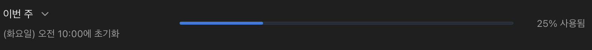
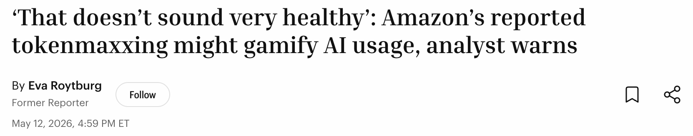

# 토큰 최적화

---

# 여러가지 최적화 기법


결국 캐시 히트률을 높이는게 중요함

---

# 토큰 팩토리
왜 이런 최적화 기법들이 필요할까

---



토큰이 많으면: 아 더 써야 하는데...
토큰이 없으면: 아 더 아껴야 하는데...

---

개발자: 일을 더 할려면 더 많은 토큰이 필요해..
기업: 토큰이 필요하다는데 돈이 너무 많이 드는데..?

## 값싸고 더 많은 토큰이 필요하다

---



---

## 이렇게 토큰을 많이 쓰는데 정말 생산성이 올라갔나?
토큰 매니지먼트가 필요하다

---

# Continuum Router & Hub
여러 LLM을 하나로 묶는 엔터프라이즈 LLM 게이트웨이

---

# 구조


Router는 요청을 처리하고, Hub는 Router를 관제한다
Router는 혼자서도 동작한다

---

# Router: 오늘 만든 라우터의 확장판

| 오늘 튜토리얼 | Continuum Router |
| :--- | :--- |
| 분류기로 small / big | 요청 난이도를 평가해 Flagship · Standard · Lightweight 티어로 |
| OpenAI 호환 주소 하나 | OpenAI · Anthropic 호환, 클라우드 API와 vLLM · SGLang · Ollama … |
| 실패하면 score로 되돌아가기 | 예비 모델 전환 · 자동 차단 · 요청량 제한 |
| | 가드레일: 민감정보 마스킹 |

---

# Router: 라우터 뒷단

```text
응답 캐시 → 공유 캐시 → Prefix 인지 라우팅 → KV 인덱스
```

같은 요청은 모델 호출 없이 바로 답하고,
나머지는 캐시를 가진 레플리카로 보내 프리필을 다시 하지 않게

---

# Hub: 토큰 매니지먼트

- 키와 권한을 한곳에서 발급, 팀별 한도
- 조직 · 팀 · 사용자 · 키 단위로 토큰 사용량 집계
- 프롬프트와 응답 본문은 저장하지 않고 토큰 수 · 모델명 · 시각만
- 추론 경로 밖에서 계량하므로 Hub가 멈춰도 서비스는 계속

---

## 앞단에서는 모델을 고르고, 뒷단에서는 캐시를 살리고
Hub로 토큰을 어디에 쓰는지 보이게

---

