# 토큰 최적화

---

# 여러가지 최적화 기법

결국 캐시 히트률을 높이는게 중요함

---

# Continuum Router

---

# 오늘 만든 라우터의 확장판

| 오늘 튜토리얼 | Continuum Router |
| :--- | :--- |
| 분류기로 small / big | 요청 난이도를 평가해 Flagship, Standard, Lightweight 티어로 |
| OpenAI 호환 주소 하나 | OpenAI, Anthropic 호환, 클라우드 API와 vLLM, SGLang, Ollama … |
| 실패하면 score로 되돌아가기 | 예비 모델 전환, 자동 차단, 요청량 제한 |
| | 가드레일: 민감정보 마스킹 |

---

# 라우터 뒷단

| 단계 | 무엇을 재사용하나 |
| :--- | :--- |
| 응답 캐시, 공유 캐시 | 요청이 **완전히 같으면** 저장된 **응답** → 모델 호출 없음 |
| Prefix 라우팅, KV 인덱스 | **앞부분이 같으면** 그 **KV 캐시**가 있는 레플리카로 → 프리필 생략 |

응답 재사용은 같은 요청에만, KV 캐시 재사용은 시스템 프롬프트, 문서, 이전 대화가 같은 요청에

---

그렇다면 내 토큰 소모, 캐시 히트률 같은 통계는 어디서?
API Key, 정책 같은 설정들은 어디서?

---

# Continuum Hub

---

# Hub: 관제와 정산

- API 키와 권한을 한곳에서 발급, 팀별 한도와 허용 모델 같은 정책도 한곳에서
- 조직, 팀, 사용자, 키 단위로 토큰 사용량, 캐시 적중, 지연 시간을 집계
- 캐시로 모델을 부르지 않은 만큼 얼마나 아꼈는지 리포트
- Router가 여러 대여도 설정은 Hub에서 한 번에, 1대씩 먼저 적용해 보고 확대

---

# Hub: 본문은 저장하지 않는다

| Router만 다루는 것 | Hub에 저장되는 것 |
| :--- | :--- |
| 프롬프트 본문 | 입력, 출력 토큰 수 |
| 모델 응답 본문 | 모델명, 프로바이더 |
| system 메시지 | 지연 시간, 완료 시각 |
| 첨부, 도구 인자 | 캐시 적중 여부 |

저장된 기록만으로는 대화 내용을 복원할 수 없다
API 키는 Hub가 발급하고, Router에는 해시만 내려간다

---

# Hub와 Router

Router는 요청 경로에, Hub는 그 바깥에
Hub가 멈춰도 요청은 계속 처리되고, 사용량은 모아 뒀다가 나중에 보낸다

---

# 하고 싶었던 이야기
* AI 시대를 대비하는 방법 -- 인사를 잘하자..
* 토큰 최적화 -- 끊임없이 일하자..
* 토큰 팩토리

---

# 래블업의 토큰 팩토리

---

사내 GPU를 통해서 여러 LLM을 서빙
앞단에는 Continuum Router를
관제는 Continuum Hub를 사용

---

여러 에이전트를 구축해서 사용중
* 이슈 자동화
* 질문 봇
* AI를 통한 E2E 테스트

---

## 감사합니다!