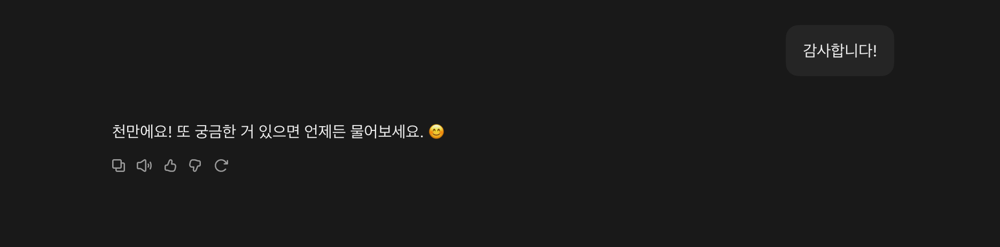
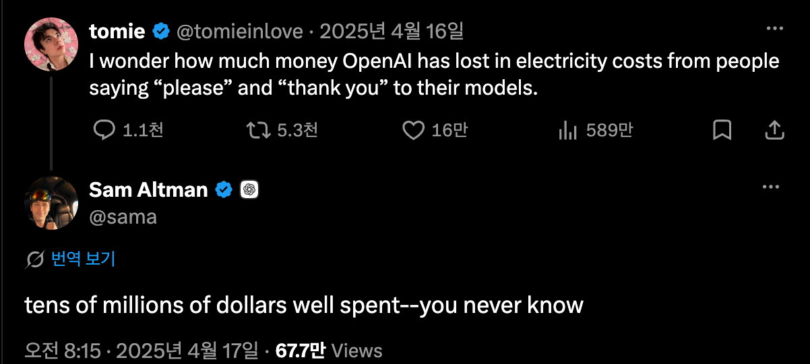

# 나만의 작고 소중한 스마트 LLM 라우터 만들기
이승원(래블업)

---

# AI 시대를 대비하는 방법

---

---

꿀팁: 인사를 잘하자

---

## 하지만 수많은 자원이 소모된다

샘 올트만도 인정한 꿀팁

---

# Smart LLM Router

---

# LLM Router

여러 모델을 하나의 endpoint로

---

# Smart LLM Router

사용자의 질문에 대해서 적절한 모델을 선택

---

# Smart LLM Router

liteLLM, RouteLLM, vLLM, Continuum Router

---

# 분류기를 간단히 구현해보자

---

# 오늘의 튜토리얼
1. 키워드 기반 분류
2. 가중치 기반 분류
3. LLM 분류
4. 채팅 페이지에서 확인
