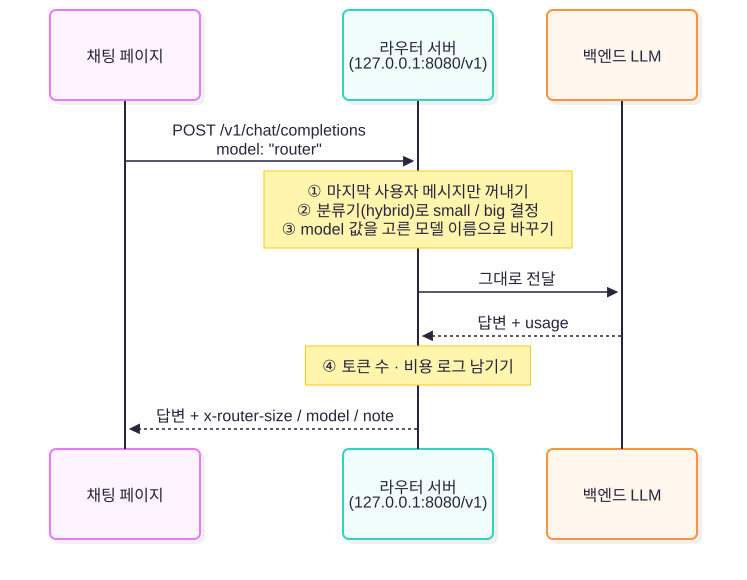
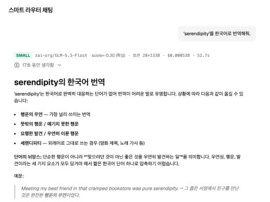

# 4단계: 라우터 서버
분류기를 OpenAI 호환 서버로

---

# 지금까지는

```bash
uv run run.py hybrid
```
질문 세트를 넣고 표로 확인했다

---

## 실제로 쓰려면
채팅 페이지도, SDK도, 에이전트도 그대로 붙일 수 있어야 한다

---

# OpenAI 호환 주소 하나



---

# 라우터 서버가 하는 일



---

# 왜 마지막 메시지만?

대화 전체를 보면 앞에서 했던 어려운 질문 때문에
"고마워!"도 큰 모델로 간다

지금 묻는 것만 보고 판단

---

# 코드: 무엇을 분류할까

```python
def last_user_text(messages: list[dict]) -> str:
    for m in reversed(messages):
        if m.get("role") != "user":
            continue
        content = m.get("content")
        if isinstance(content, str):
            return content
        if isinstance(content, list):  # [{"type": "text", "text": ...}, ...]
            return " ".join(p.get("text", "") for p in content if p.get("type") == "text")
    return ""
```

---

# 코드: 분류기 고르기

```python
def choose(body: dict) -> tuple[str, str]:
    if body.get("model") in llm.MODELS:  # "small" / "big" 직접 지정
        return body["model"], "지정"
    result = CLASSIFIERS[CLASSIFIER](last_user_text(body.get("messages", [])))
    return result if isinstance(result, tuple) else (result, "")
```

---

# 코드: model 바꿔치기

```python
size, note = choose(body)
body["model"] = llm.MODELS[size]          # "router" → 실제 모델 이름
if body.get("stream"):
    body["stream_options"] = {"include_usage": True}  # 스트림 끝에서 토큰 수 받기
router_headers = {
    "x-router-size": size,
    "x-router-model": llm.MODELS[size],
    "x-router-note": urllib.parse.quote(note),  # 헤더는 ASCII만 되므로 인코딩
    "x-router-price": "{},{}".format(*llm.PRICES[size]),  # 비용 계산용
}
```

나머지 요청은 손대지 않고 백엔드 LLM에 그대로 전달

---

# 서버 띄우기

```bash
cd final
uv run server.py                              # http://127.0.0.1:8080, 분류기 hybrid
CLASSIFIER=score PORT=9000 uv run server.py   # 분류기, 포트 바꾸기
```

브라우저로 `http://127.0.0.1:8080`을 열면 채팅 페이지

---

# 채팅 페이지에서 대화하기



---

# 답변마다 라우팅 결과

| 표시 | 뜻 |
| :--- | :--- |
| `SMALL` / `BIG` | 라우터가 고른 모델 |
| `zai-org/GLM-5.3-Flash` | 실제로 답한 모델 |
| `score=-0.30 (확실)` | 왜 그렇게 골랐는지 |
| `토큰 29+964 · $0.000389 · 48.9s` | 이번 답변의 토큰, 비용, 시간 |

응답 헤더 `x-router-*`를 읽어서 보여 준다

---

# 터미널에도 찍힌다

```text
[router] small zai-org/GLM-5.3-Flash  score=-0.30 (확실)  토큰 28+683  $0.000276  40.0s
[router] small zai-org/GLM-5.3-Flash  score=+0.35 (애매) → llm=easy  토큰 29+964  $0.000389  48.9s
[router] big   deepseek-ai/DeepSeek-V4.1-Flash  score=+0.95 (확실)  토큰 149+2275  $0.018498  73.3s
```
어느 모델로 갔는지, 얼마 들었는지 바로 보인다

---

# 해 보기

- 쉬운 질문, 어려운 질문을 섞어서 대화해 보자
- 입력창 아래에서 **자동 라우팅 → 큰 모델**로 바꿔 같은 질문의 비용을 비교해 보자
- 퀴즈의 함정 질문도 넣어 보자
  "고마워! 그런데 하나만 더. 서버 여러 대가 같은 캐시를 쓰는데, …"
- 분류기를 바꿔 다시 켜 보자: `CLASSIFIER=score uv run server.py`

---

# 정리

분류기 + 표준 라이브러리 `http.server` = 나만의 스마트 라우터

채팅 페이지도 같은 주소에서

추가 패키지 없이, 주소 하나로

(실습용이라 인증이 없으니 외부에 공개하지 말 것)
